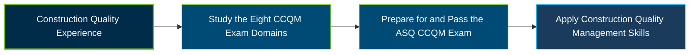

# ASQ Certified Construction Quality Manager (CCQM) Certification Exam Guide

A dedicated study guide and construction quality management reference for professionals preparing for the **ASQ Certified Construction Quality Manager (CCQM) Certification Exam**, covering project quality planning, construction processes, compliance, and continuous improvement.

---

## Exam Overview

The ASQ Certified Construction Quality Manager (CCQM) certification validates the knowledge and skills required to manage construction quality throughout a project lifecycle, from pre-contract planning and design through construction, turnover, and ongoing operations.

- **Exam Format**: Computer-delivered, open-book, multiple-choice examination.
- **Target Audience**: Construction quality managers, project quality professionals, construction managers, and professionals responsible for quality planning and project delivery.
- **Prerequisites**: Eight years of full-time, paid work experience in relevant Body of Knowledge areas, including three years in a decision-making position. Education-based experience waivers are available.

---

## Core Exam Domains & Knowledge Areas

### 1. Pre-contract Phase

- Project delivery methods, contract types, payment models, and payment documentation.
- Contractual requirements, project scope, schedules, resources, and stakeholder responsibilities.
- Bid evaluation, bidder prequalification, quality criteria, and contract finalization.

### 2. Planning Phase

- Strategic quality planning, project quality strategies, ESG practices, and alignment of project plans.
- Quality management systems, quality assurance, quality control, and industry standards.
- Resource planning, quality audits, measurement systems analysis, and quality management tools.

### 3. Design Phase

- Design inputs, quality objectives, functional and nonfunctional requirements, and lessons learned.
- Design coordination, stakeholder involvement, constructability reviews, and QMS feedback.
- Design outputs, verification and validation, design changes, and quality documentation.

### 4. Procurement

- Procurement quality requirements, trade partner alignment, and inspection and testing plans.
- Resource management, material traceability, vendor requirements, and resource mobilization.
- Risk identification and treatment, quality reporting, and vendor performance evaluation.

### 5. Construction

- Quality plan deployment, construction submittals, permits, material evaluation, and change requests.
- Risk-based inspection, testing, nonconformance control, corrective actions, and process management.
- Compliance monitoring, acceptance criteria, quality reporting, commissioning, and continuous improvement.

### 6. Project Turnover and Closeout

- Documentation management, inspection records, and quality deliverable verification.
- Nonconforming work closure, final certification, and turnover requirements.
- Closeout documentation, as-built drawings, commissioning reports, and warranty management.

### 7. Operations and Maintenance

- Sustaining quality requirements and preparing objectives for operations and maintenance.
- Maintenance programs, future inspection strategies, and customer expectations.
- Business continuity planning, operational resilience, and shutdown-related quality impacts.

### 8. Quality Manager Skills

- ASQ Code of Ethics, stakeholder alignment, collaboration, and negotiation.
- Team building, communication, conflict resolution, and change management.
- Cost of Quality, Lean and Six Sigma improvement methods, and customer satisfaction.

---

## Certification Path

---

## Recommended Practice & Study Resources

Use the official ASQ Body of Knowledge alongside construction-focused study materials and practical quality management exercises.

- **CertsGate**: Explore [ASQ CCQM certification preparation resources](https://certsgate.com/exams/asq/ccqm) for supplementary study materials and practice opportunities.
- **Practical Study Resource**: Use the [ASQ Certified Construction Quality Manager Handbook](https://asq.org/quality-press/display-item?item=H1646) to reinforce construction quality planning, procurement, inspection, project closeout, and quality management concepts.
